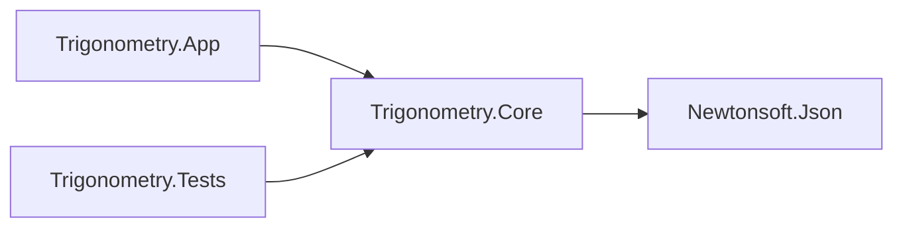

# Lab7 — вариант 1

Тригонометрический калькулятор: sin, cos, tg и ctg по рядам Тейлора, радианы и градусы, 0–12 знаков после запятой.

```text
dotnet build Lab7/Lab7.slnx
dotnet test Lab7/Lab7.slnx
dotnet run --project Lab7/Trigonometry.App -- --memory
```

Без `--memory` история хранится в `history.jsonl`; вместо него можно передать путь к файлу.
В полюсах (модуль знаменателя не больше 10⁻¹⁴) tg/ctg обозначаются как неопределённые.
Диапазон входного угла: от −1000000 до 1000000. Расчёты выполняются в double, вывод округляется до выбранного числа знаков.



Core содержит контракт ICalculationHistory и реализации MemoryHistory/FileHistory. Хранилище внедряется в Calculator через конструктор. Для файловой истории используется NuGet-пакет Newtonsoft.Json 13.0.4. Core не зависит от App и не обращается к Console. Алгоритмы приведения угла и рекуррентного суммирования адаптированы из исходных Lab7 и Lab8.
