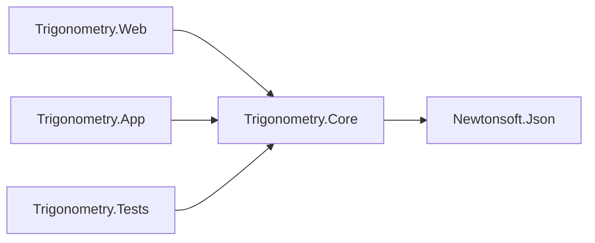

# Lab7 — тригонометрический калькулятор для Mac

Из общей папки «Готовые лабораторные»:

```text
dotnet run --project Lab7/Trigonometry.Web
```

Откройте http://127.0.0.1:5077. Для остановки — Ctrl+C в терминале.

Укажите угол, градусы или радианы и 0–12 знаков после запятой. В браузере отображаются sin, cos, tg, ctg и последние 30 вычислений. Допустимы точка и запятая. Диапазон угла: ±1000000. Если модуль знаменателя не больше 10⁻¹⁴, tg/ctg обозначается как неопределённый.

История в памяти хранится до перезапуска сервера. Файловая история сохраняется локально в Trigonometry.Web/Data/history.jsonl. Доступ к общим экземплярам калькулятора синхронизирован, данные истории не включаются в Git.

## Структура

- Trigonometry.Core — вычисления по рядам Тейлора, контракт ICalculationHistory и реализации MemoryHistory/FileHistory. NuGet Newtonsoft.Json используется для файловой истории.
- Trigonometry.Web — ASP.NET Core minimal API и HTML/CSS/JavaScript, без WinForms. Вычисления выполняются на C# в Core; JavaScript только передаёт данные и отображает результат.
- Trigonometry.App — сохранённый консольный интерфейс к той же библиотеке.
- Trigonometry.Tests — 19 тестовых случаев логики ядра.



```text
dotnet build Lab7/Lab7.slnx
dotnet test Lab7/Lab7.slnx
dotnet run --project Lab7/Trigonometry.App -- --memory
```

Проверены HTTP-запросы: градусы, радианы, тангенс при 90°, неверный угол/точность/хранилище, параллельные запросы истории и сохранение файловой истории после перезапуска. Проверены браузерные сценарии: расчёт, ошибка ввода, отображение истории.

Веб-интерфейс добавлен к исходной Lab7; ядро и его тесты сохранены. Это также выполняет бонусное требование второго интерфейса к библиотеке. Сервер по умолчанию слушает только loopback этого компьютера.
